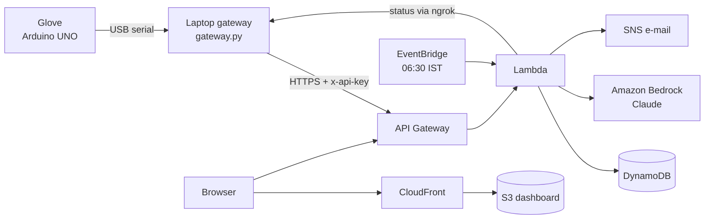

<p align="center"></p>

# MØIST

**A glove that sorts wet waste from dry, without the worker touching it, plus a live waste-to-energy dashboard on AWS.**

Built for *Environmental Hacks: Waste & Energy* by Lovekesh and Dua.

India's municipal waste is about half wet. Mixed in, the wet fraction soaks the dry fraction, which is then too damp for waste-to-energy plants. Sorting at collection points is done by hand and leaves no record of how well each area segregates. MØIST measures each item at the point of collection and turns those readings into decisions for the city.

## What it does

| | |
|---|---|
| **No-touch glove** | An ultrasonic sensor detects an item about 12 cm away. A servo lowers a two-contact probe onto it and reads its conductivity seven times. A green, red or amber LED shows *dry*, *wet* or *unsure* in under a second. |
| **Live sorting** | Every reading reaches the dashboard within about 2 seconds, with its moisture score, certainty, collection point and glove. |
| **Energy planner** | Each collection point gets an **Energy Suitability Index** (0–100) from its dry share and moisture, plus one recommended action: send to the energy plant, run a segregation drive, inspect, or monitor. |
| **AI assistant** | **Claude on Amazon Bedrock** writes a 06:30 morning brief for the ward officer and answers questions such as *"Which area needs a segregation drive first?"*. It only explains figures the system has already computed; it never classifies waste. |
| **Fault detection** | Readings from a shorted probe (metal) or a gas spike are flagged, excluded from the statistics and e-mailed through SNS. |
| **Works offline** | If the connection drops, the gateway queues readings and sends them when it returns. |

## Architecture



One SAM template (`backend/template.yaml`) creates the whole stack. ngrok is used only so AWS can read the laptop gateway's status page, which shows whether the glove is plugged in. Readings go straight from the laptop to API Gateway.

## Run it on a laptop (no AWS account)

```bash
python backend/local.py                 # API on http://localhost:8787 (data in backend/local-data.json)
python backend/seed.py                  # optional: demo areas + 30 days of SIMULATED readings (gloves named sim-*)
python gateway/gateway.py --port COM5   # real glove -> API   (pip install pyserial; close the Serial Monitor first)
cd web && npm install && npm run dev    # dashboard on http://localhost:5173
```

Locally the AI features show a rule-based brief and say that Bedrock is not connected. They switch to Claude once the backend runs on AWS.

Tests: `python backend/test_backend.py` and `cd gateway && python test_gateway.py` (both print `ok`).

## Deploy to AWS

See **[DEPLOY.md](DEPLOY.md)** for every step: tools, credentials, Bedrock model access, `sam deploy`, S3 + CloudFront, ngrok, the glove, and a final checklist.

## Repository

```
arduino/    glove firmware and test sketches            (see hardware.md)
gateway/    USB serial -> API, offline outbox, status endpoint for ngrok
backend/    AWS SAM app: one Lambda API, Bedrock brief + questions, local server, demo seeder
web/        React dashboard: landing page, Overview, Live sorting, AI assistant, Energy planner, Areas, Alerts
docs/       tracking.md (fields, metrics, API), wiring diagram, README banner
```

The banner is rendered from the landing page's sky gradient: run `npm run dev` in `web/`, open `/banner.html` and take a 1600×560 screenshot.

## Security

Posting readings and editing areas need the `x-api-key`. The gateway status page needs its own token. The dashboard is read-only apart from the action-queue status and AI questions (capped at 60 per hour). Add Amazon Cognito sign-in before sharing the URL beyond the team.
