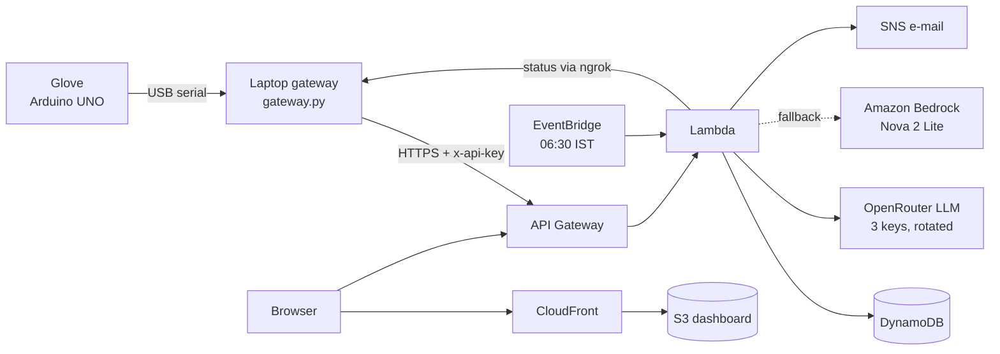

<p align="center"></p>

# MØIST

**A glove that sorts wet waste from dry, without the worker touching it, plus a live waste-to-energy dashboard on AWS.**

Built for *Environmental Hacks: Waste & Energy* (WeMakeDevs × AWS) by **Lovekesh** and **Dua**.

| | |
|---|---|
| **Live dashboard** | **https://dfznu6n6x1fm2.cloudfront.net** |
| **API** | `https://9k9jowx1pf.execute-api.ap-south-1.amazonaws.com` (try [`/health`](https://9k9jowx1pf.execute-api.ap-south-1.amazonaws.com/health)) |
| **Region** | AWS Asia Pacific (Mumbai) `ap-south-1` |

## The problem

About half of India's municipal solid waste is wet. When it is mixed in, it soaks the dry fraction, which is then too damp for waste-to-energy plants to burn efficiently. Sorting at collection points is done by sight, smell and hand. It exposes workers to health risks and leaves no record of how well each area segregates.

MØIST measures each item at the point of collection, without the worker touching it, and turns those readings into decisions for the city: which collection points can send their waste straight to the energy plant, and which need a segregation drive.

## What it does

| | |
|---|---|
| **No-touch glove** | An ultrasonic sensor detects an item about 12 cm away. A servo lowers a two-contact probe onto it and reads its conductivity seven times. A green, red or amber LED shows *dry*, *wet* or *unsure* in under a second. |
| **Live sorting** | Every reading reaches the dashboard within about 2 seconds, with its moisture score, certainty, collection point and glove. |
| **Energy planner** | Each collection point gets an **Energy Suitability Index** (0–100) from its dry share and moisture, and one recommended action: send to the energy plant, run a segregation drive, inspect, or monitor. Officers track each action as open, scheduled or done. |
| **AI assistant** | An LLM writes a 06:30 morning brief for the ward officer and answers questions such as *"Which area needs a segregation drive first?"*. It only explains figures the system has already computed; it never classifies waste. |
| **Fault detection** | Readings from a shorted probe (metal) or a gas spike are flagged, excluded from the statistics and e-mailed through SNS. |
| **Live glove status** | The hosted dashboard shows whether the glove is plugged in right now, read from the laptop gateway through an ngrok tunnel. |
| **Works offline** | If the connection drops, the gateway queues readings and sends them when it returns. |

## Architecture



One SAM template (`backend/template.yaml`) creates the whole stack. Readings go straight from the laptop to API Gateway. ngrok is used only in the other direction, so the Lambda can read the gateway's status page.

### AWS services used

| Service | What it runs in MØIST |
|---|---|
| **Amazon API Gateway** (HTTP API) | Public HTTPS endpoint for the glove gateway and the dashboard, throttled to 25 req/s |
| **AWS Lambda** (Python 3.14, arm64) | All backend logic: validates and classifies readings, computes the Energy Suitability Index and actions, serves the dashboard data, calls the LLM, reads the gateway status |
| **Amazon DynamoDB** (on-demand) | `Readings` (by area and time, plus a by-day index), `Areas`, `State` (action queue, latest brief, AI question counter) |
| **Amazon EventBridge Scheduler** | Runs the morning brief every day at 06:30 IST |
| **Amazon SNS** | E-mails fault alerts and the morning brief |
| **Amazon S3** | Stores the dashboard build (private bucket) |
| **Amazon CloudFront** | Serves the dashboard over HTTPS through Origin Access Control |
| **Amazon Bedrock** | Fallback LLM (Amazon Nova 2 Lite) when the OpenRouter keys are unavailable |
| **Amazon CloudWatch Logs** | Lambda logs, kept for 7 days |
| **AWS IAM** | Least-privilege role for the Lambda: its own tables, its topic, Bedrock |
| **AWS CloudFormation** (SAM) | Creates, updates and deletes the whole stack from one template |

### AI

`backend/src/brief.py` sends the **per-area numbers** (never raw readings) to a language model and asks for a short brief or an answer to the officer's question. Providers are tried in order until one answers:

1. **OpenRouter**, once per API key (three keys, so a rate-limited key falls through to the next). Each call lists free models in order of preference: `nvidia/nemotron-3-super-120b-a12b:free`, then `google/gemma-4-31b-it:free`, then `google/gemma-4-26b-a4b-it:free`.
2. **Amazon Bedrock**, Amazon Nova 2 Lite, when the account has Bedrock quota.
3. A **rule-based brief**, so the dashboard always has one. The footer says which one you are reading.

## Run it on a laptop (no AWS account)

```bash
cp backend/.env.example backend/.env    # optional: add OpenRouter keys for the AI features
python backend/local.py                 # API on http://localhost:8787 (data in backend/local-data.json)
python backend/seed.py                  # optional: demo areas + 30 days of SIMULATED readings (gloves named sim-*)
pip install pyserial
python gateway/gateway.py --port COM5   # real glove -> API (close the Arduino Serial Monitor first)
                                        # to send to AWS instead: copy gateway/.env.example to gateway/.env and fill it in
cd web && npm install && npm run dev    # dashboard on http://localhost:5173
```

`python backend/seed.py --live` streams simulated readings if the glove is not at hand. The dashboard labels them "simulated".

Tests: `python backend/test_backend.py` and `cd gateway && python test_gateway.py` (both print `ok`).

## Deploy to AWS

See **[DEPLOY.md](DEPLOY.md)** for every step: tools, credentials, AI keys, `sam deploy`, S3 + CloudFront, ngrok, the glove, a judging checklist, costs and teardown.

## Hardware

An Arduino UNO with an HC-SR04 ultrasonic sensor, an SG90 servo probe arm, a conductivity probe, a DHT11, an 8×8 MAX7219 matrix, LEDs and a buzzer, powered over USB. See **[hardware.md](hardware.md)** for parts, pin map, build order and calibration, and the wiring diagram below.

<p align="center"></p>

## Repository

```
arduino/    glove firmware (moist_glove) and test sketches         see hardware.md
gateway/    USB serial -> API, offline outbox, status endpoint for ngrok
backend/    AWS SAM app: one Lambda API, AI brief + questions, local server, demo seeder, tests
web/        React + Vite dashboard: landing page, Overview, Live sorting, AI assistant, Energy planner, Areas, Alerts
docs/       tracking.md (fields, metrics, API), wiring diagram, README banner
```

The README banner is rendered from the landing page's sky gradient: run `npm run dev` in `web/`, open `/banner.html` and take a 1600×560 screenshot.

## Security

- Posting readings and editing areas need the `x-api-key`. The gateway status page needs its own token.
- Secrets (API key, gateway token, OpenRouter keys) live in `backend/samconfig.toml` and `backend/.env`, both gitignored, and reach the Lambda as hidden CloudFormation parameters.
- The dashboard is read-only apart from the action-queue status and AI questions (capped at 60 per hour). Add Amazon Cognito sign-in before sharing the URL beyond the team.

## Team

**Lovekesh** and **Dua**, Environmental Hacks 2026.
