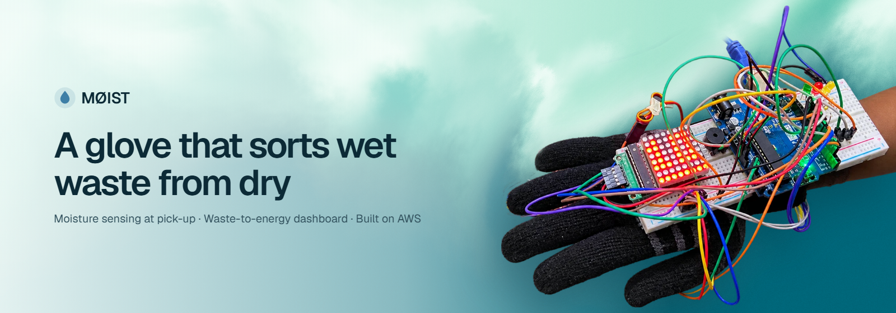
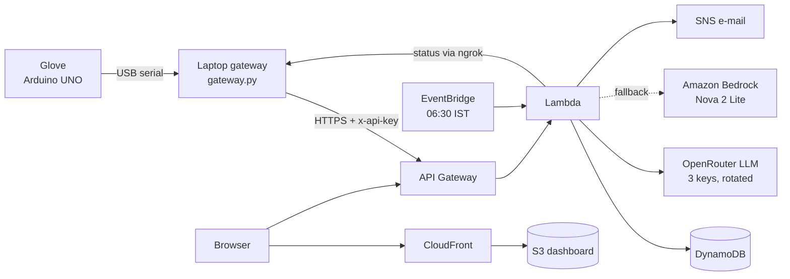
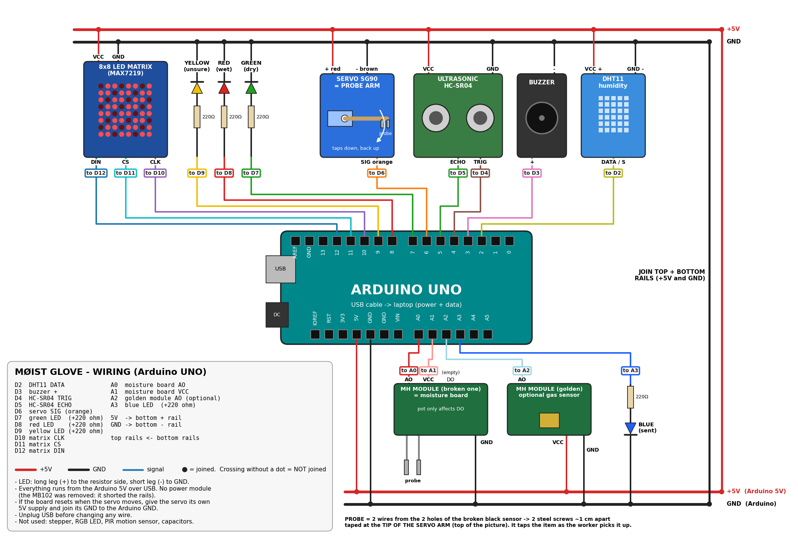

<p align="center"></p>

# MØIST

**A work glove that tells wet waste from dry as the worker picks it up, plus a live waste-to-energy dashboard on AWS.**

Built for *Environmental Hacks: Waste & Energy* (WeMakeDevs × AWS) by **Lovekesh** and **Dua**.

| | |
|---|---|
| **Live dashboard** | **https://dfznu6n6x1fm2.cloudfront.net** |
| **API** | `https://9k9jowx1pf.execute-api.ap-south-1.amazonaws.com` (try [`/health`](https://9k9jowx1pf.execute-api.ap-south-1.amazonaws.com/health)) |
| **Region** | AWS Asia Pacific (Mumbai) `ap-south-1` |

## The problem

About half of India's municipal solid waste is wet. When it is mixed in, it soaks the dry fraction, which is then too damp for waste-to-energy plants to burn efficiently. Sorting at collection points is done by sight and smell. Nobody measures how wet a load is, so there is no record of how well each area segregates and no way to tell which loads are dry enough to burn.

MØIST measures each item at the moment the worker picks it up, with the glove they already wear, and turns those readings into decisions for the city: which collection points can send their waste straight to the energy plant, and which need a segregation drive.

## The gap it fills

| Today | The gap | MØIST |
|---|---|---|
| Segregation at collection points is judged by eye and nose | No measurement of how wet a load actually is | Every item gets a moisture reading at pick-up |
| Moisture is measured in a lab (oven drying, hours) or with a hand-held meter | A separate, slow step that nobody does on a collection round | The measurement is built into the glove the worker already wears |
| Waste-to-energy plants find out a load is too wet when it arrives | No upstream signal of which areas send dry, burnable waste | An Energy Suitability Index per collection point, updated live |
| Segregation drives are planned from complaints and occasional audits | No ward-level data on where segregation is failing | A ranking with one recommended action per area, plus a daily brief |
| The Solid Waste Management Rules 2026 require segregation into 4 streams with online tracking | No low-cost way to produce that record at the source | Every reading is stored with time, place and glove, on AWS |

Smart bins and camera sorting lines exist, but they are expensive and sit at material-recovery facilities, late in the chain, after the waste is already mixed. Nothing measures moisture **at the worker's hand, at the point of collection**, and turns it into city data.

## Why it is unique

- **Measurement during the pick-up motion.** The ultrasonic sensor triggers the probe as the hand closes in, so the reading costs the worker no time and no extra device.
- **From one item to a city decision.** The same reading that lights an LED on the wrist feeds a per-area Energy Suitability Index and a recommended action: send to the plant, run a segregation drive, inspect, or monitor.
- **Honest about uncertainty.** Readings between the dry and wet thresholds are reported as *unsure* instead of being forced into a class. Faulty readings (a metal can shorting the probe, a gas spike) are flagged and excluded, not averaged in.
- **AI that explains, not guesses.** The language model only turns figures the system has computed into a plain-language brief or answer. It never classifies waste.
- **Built from common parts.** An Arduino UNO, an ultrasonic sensor, a hobby servo and a two-screw conductivity probe, on an ordinary work glove.

## Advantages

| For | Advantage |
|---|---|
| **Sanitation workers** | Wet, dry or unsure in under a second, on the wrist, before the item goes in a bin. No guesswork, no extra tool to carry. |
| **Ward officers** | A live ranking of collection points, one recommended action each, a 06:30 brief by e-mail, and fault alerts. |
| **Waste-to-energy plants** | Dry, high-ESI loads can be routed directly to the plant, so less wet waste lowers the calorific value of the feed. |
| **City and compliance** | An online, per-area record of segregation quality, as the 2026 rules require. |
| **Cost and operations** | Serverless on AWS: no servers to run, near-zero cost when idle. The gateway queues readings offline and sends them when the network returns. |

## What it does

| | |
|---|---|
| **Sensing glove** | As the hand closes in on an item, an ultrasonic sensor detects it about 12 cm away and a servo taps a two-contact probe onto it, reading its conductivity seven times. A green, red or amber LED shows *dry*, *wet* or *unsure* in under a second, while the item is still in hand. |
| **Live sorting** | Every reading reaches the dashboard within about 2 seconds, with its moisture score, certainty, collection point and glove. |
| **Energy planner** | Each collection point gets an **Energy Suitability Index** (0–100) from its dry share and moisture, and one recommended action: send to the energy plant, run a segregation drive, inspect, or monitor. Officers track each action as open, scheduled or done. |
| **AI assistant** | An LLM writes a 06:30 morning brief for the ward officer and answers questions such as *"Which area needs a segregation drive first?"*. It only explains figures the system has already computed; it never classifies waste. |
| **Fault detection** | Readings from a shorted probe (metal) or a gas spike are flagged, excluded from the statistics and e-mailed through SNS. |
| **Live glove status** | The hosted dashboard shows whether the glove is plugged in right now, read from the laptop gateway through an ngrok tunnel. |
| **Works offline** | If the connection drops, the gateway queues readings and sends them when it returns. |

## Architecture



One SAM template (`backend/template.yaml`) creates the whole stack. Readings go straight from the laptop to API Gateway. ngrok is used only in the other direction, so the Lambda can read the gateway's status page.

### AWS services used

| Service | What it runs in MØIST |
|---|---|
| **Amazon API Gateway** (HTTP API) | Public HTTPS endpoint for the glove gateway and the dashboard, throttled to 25 req/s |
| **AWS Lambda** (Python 3.14, arm64) | All backend logic: validates and classifies readings, computes the Energy Suitability Index and actions, serves the dashboard data, calls the LLM, reads the gateway status |
| **Amazon DynamoDB** (on-demand) | `Readings` (by area and time, plus a by-day index), `Areas`, `State` (action queue, latest brief, AI question counter) |
| **Amazon EventBridge Scheduler** | Runs the morning brief every day at 06:30 IST |
| **Amazon SNS** | E-mails fault alerts and the morning brief |
| **Amazon S3** | Stores the dashboard build (private bucket) |
| **Amazon CloudFront** | Serves the dashboard over HTTPS through Origin Access Control |
| **Amazon Bedrock** | Fallback LLM (Amazon Nova 2 Lite) when the OpenRouter keys are unavailable |
| **Amazon CloudWatch Logs** | Lambda logs, kept for 7 days |
| **AWS IAM** | Least-privilege role for the Lambda: its own tables, its topic, Bedrock |
| **AWS CloudFormation** (SAM) | Creates, updates and deletes the whole stack from one template |

### AI

`backend/src/brief.py` sends the **per-area numbers** (never raw readings) to a language model and asks for a short brief or an answer to the officer's question. Providers are tried in order until one answers:

1. **OpenRouter**, once per API key (three keys, so a rate-limited key falls through to the next). Each call lists free models in order of preference: `nvidia/nemotron-3-super-120b-a12b:free`, then `google/gemma-4-31b-it:free`, then `google/gemma-4-26b-a4b-it:free`.
2. **Amazon Bedrock**, Amazon Nova 2 Lite, when the account has Bedrock quota.
3. A **rule-based brief**, so the dashboard always has one. The footer says which one you are reading.

## Run it on a laptop (no AWS account)

```bash
cp backend/.env.example backend/.env    # optional: add OpenRouter keys for the AI features
python backend/local.py                 # API on http://localhost:8787 (data in backend/local-data.json)
python backend/seed.py                  # optional: demo areas + 30 days of SIMULATED readings (gloves named sim-*)
pip install pyserial
python gateway/gateway.py --port COM5   # real glove -> API (close the Arduino Serial Monitor first)
                                        # to send to AWS instead: copy gateway/.env.example to gateway/.env and fill it in
cd web && npm install && npm run dev    # dashboard on http://localhost:5173
```

`python backend/seed.py --live` streams simulated readings if the glove is not at hand. The dashboard labels them "simulated".

Tests: `python backend/test_backend.py` and `cd gateway && python test_gateway.py` (both print `ok`).

## Deploy to AWS

See **[DEPLOY.md](DEPLOY.md)** for every step: tools, credentials, AI keys, `sam deploy`, S3 + CloudFront, ngrok, the glove, a judging checklist, costs and teardown.

## Hardware

An Arduino UNO with an HC-SR04 ultrasonic sensor, an SG90 servo probe arm, a conductivity probe, a DHT11, an 8×8 MAX7219 matrix, LEDs and a buzzer, powered over USB. See **[hardware.md](hardware.md)** for parts, pin map, build order and calibration, and the wiring diagram below.

<p align="center"></p>

## Repository

```
arduino/    glove firmware (moist_glove) and test sketches         see hardware.md
gateway/    USB serial -> API, offline outbox, status endpoint for ngrok
backend/    AWS SAM app: one Lambda API, AI brief + questions, local server, demo seeder, tests
web/        React + Vite dashboard: landing page, Overview, Live sorting, AI assistant, Energy planner, Areas, Alerts
docs/       tracking.md (fields, metrics, API), wiring diagram, README banner
```

The README banner is rendered from the landing page's sky gradient: run `npm run dev` in `web/`, open `/banner.html` and take a 1600×560 screenshot.

## Security

- Posting readings and editing areas need the `x-api-key`. The gateway status page needs its own token.
- Secrets (API key, gateway token, OpenRouter keys) live in `backend/samconfig.toml` and `backend/.env`, both gitignored, and reach the Lambda as hidden CloudFormation parameters.
- The dashboard is read-only apart from the action-queue status and AI questions (capped at 60 per hour). Add Amazon Cognito sign-in before sharing the URL beyond the team.

## Team

| Member | Contribution |
|---|---|
| **Lovekesh Anand** ([@LovekeshAnand](https://github.com/LovekeshAnand)) | Glove hardware and firmware, calibration, USB gateway, AWS backend (SAM, Lambda, DynamoDB, SNS, EventBridge), AI integration, deployment, demo video |
| **Dua Saeed** ([@Dua-Saeed641](https://github.com/Dua-Saeed641)) | UI and frontend: dashboard design and pages |

## Credits and tools

**AI tools used while building** (as the rules require): **Claude Code** (Anthropic), an AI coding assistant, helped write and review the code, the AWS template and the docs.

**AI models used by the app:** NVIDIA Nemotron 3 Super 120B and Google Gemma 4 (free models through [OpenRouter](https://openrouter.ai)), and Amazon Nova 2 Lite on Amazon Bedrock as the fallback.

**Open-source code and assets:**

| | License |
|---|---|
| [React](https://react.dev), [Vite](https://vitejs.dev), [TypeScript](https://www.typescriptlang.org) | MIT, MIT, Apache-2.0 |
| [Recharts](https://recharts.org) (charts) | MIT |
| [Leaflet](https://leafletjs.com) + [React Leaflet](https://react-leaflet.js.org) (map) | BSD-2-Clause, Hippocratic-2.1 |
| Map tiles © [OpenStreetMap](https://www.openstreetmap.org/copyright) contributors | ODbL |
| [Hugeicons](https://hugeicons.com) free icons | MIT |
| "SkyGradient" (Mint sky) WebGL background, exported from [FeralUI](https://feralui.com) | per FeralUI's terms |
| [Geist and Geist Mono](https://vercel.com/font) fonts via Google Fonts | SIL OFL 1.1 |
| Arduino `Servo` and Adafruit `DHT sensor library` | LGPL-2.1, MIT |
| [boto3](https://github.com/boto/boto3), [pyserial](https://github.com/pyserial/pyserial), [AWS SAM](https://aws.amazon.com/serverless/sam/) | Apache-2.0, BSD-3-Clause, Apache-2.0 |
| Problem statistics on the landing page | from the team's project report |
