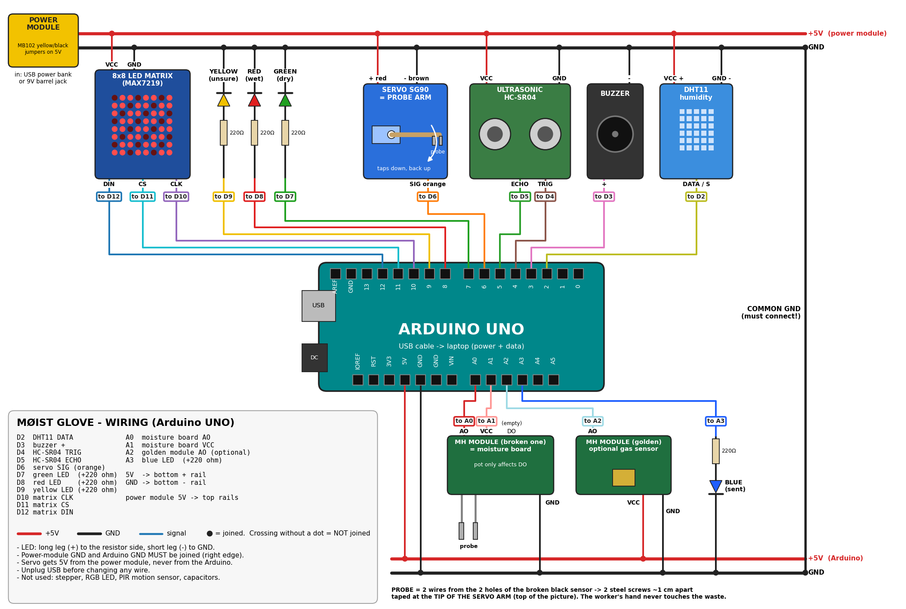

# MØIST glove: hardware

Everything needed to build and run the glove. The firmware is in `arduino/moist_glove/moist_glove.ino`.
For the data it sends to the dashboard, see [`docs/tracking.md`](docs/tracking.md).

(Vector version: `docs/wiring.svg`. To redraw it after changing a pin, edit and run `python docs/wiring.py`.)

## The idea: the worker never touches the waste

The moisture probe sits at the **tip of a 12 to 15 cm stick fixed to the servo**. The worker holds the hand above the item. When the distance is right, the **servo swings the stick down**, taps the item for about 0.7 s, reads it and swings back up. The hand stays about 15 cm away the whole time.

Why not fully contact-free? With these parts, nothing can measure an item's moisture from a distance. The humidity sensor reads the air, slowly, and the gas sensor reads smell. Both are useful as "something wet or rotting is near" hints, so they drive the beeping, but the actual wet/dry decision needs the probe to touch the item. The servo arm handles that touch, so the worker doesn't have to.

## How wet or dry is decided

1. **Water conducts electricity and dry material doesn't.** The probe's two steel screws touch the item. Wet items let current flow between them; dry ones barely do.
2. **The MH module turns that into a voltage.** A fixed resistor on the board and the probe share the 5V between them, so the voltage at **AO** changes with the item's wetness. The Arduino reads it on A0 as a number from **0 to 1023** (`moisture_raw`).
3. **Calibration gives that number a meaning.** Dry paper gives `RAW_DRY`, a wet sponge gives `RAW_WET`, and the code maps any reading onto a **score from 0 (dry) to 1 (wet)**. It works whether your board's number goes up or down when wet.
4. **Thresholds decide the class:** score ≤ 0.38 → **dry**, ≥ 0.62 → **wet**, anything in between → **uncertain**. Saying "not sure" beats a confident wrong answer.
5. **The median of 7 readings** over 0.7 s ignores a single noisy spike if the probe wobbles.

Humidity (DHT11) and gas (golden module) only measure the **air**, so they're used as hints while hovering, not for the decision. Weak spots: metal reads as wet, wet plastic with a thin film of water may read dry, and the screws slowly corrode.

## What it does

| Situation | 8x8 matrix | Buzzer | LEDs / servo |
|---|---|---|---|
| Nothing within 30 cm | small dot in the middle | silent | arm parked up |
| Item 12 to 30 cm away | number **0 to 10** (10 = the arm can reach) plus a bar on the bottom row | ticks faster the stronger the wet/rotting signal (humidity + gas), like a metal detector | off |
| Held at **10** for 0.6 s | **W**, **D** or **?** for 2 s | 1 beep, or **3 beeps if wet** | arm taps down and back up. Green = dry, red = wet, yellow = unsure, blue = reading sent |

Keep the hand still while the arm taps (about 1.5 s). After a reading, move the hand away (more than 15 cm) before the next one starts. This stops the same item from being logged twice.

**About left/right arrows:** one ultrasonic sensor only measures distance, so it can't tell whether the item is to the left or right. Arrows would need a second HC-SR04 angled about 20° away from the first. The matrix shows how close the hand is instead.

**About the PIR motion sensor:** it detects *people moving*, and it also triggers whenever the glove itself moves, so it adds nothing on the glove. It would only be useful on a fixed bin station that wakes up when someone walks up to it.

## Parts

| Part | Used for | Notes |
|---|---|---|
| Arduino UNO | brain | USB to the laptop (power and data). Shows up as **COM5** |
| 8x8 LED matrix (MAX7219, 5 pins) | distance number and result | If yours has 16 pins and no chip, it won't work with this wiring |
| HC-SR04 ultrasonic | hand-to-item distance, auto-trigger | Mount beside the servo arm, facing down and forward |
| DHT11 humidity sensor | air temperature and humidity | Use a 3-pin module. A bare 4-pin sensor needs a 10 kΩ resistor between VCC and DATA |
| **Broken** MH-sensor module (its black sensor snapped off) | **becomes the moisture board** | See "Making the probe" below |
| MH-sensor module with the golden cylinder | optional, logged as `gas_raw` | Read the text printed on it. If it says **MQ-xxx** it's a gas sensor, so keep it. If it says **SW-420** it's a vibration switch: set `HAS_AUX = false` and leave it off |
| Buzzer | metal-detector beeping | Longer leg / `+` goes to D3 |
| Servo SG90 | **probe arm**: swings the probe onto the item and back | Powered from the power module, **not** the Arduino |
| LEDs: green, red, yellow, blue | result and status | Each needs a **220 Ω** resistor (red-red-brown) |
| Power module MB102 (yellow/black) | 5V for the matrix, servo, sonar and DHT | Set both jumpers to **5V**. Power it with a USB power bank or a 9V adapter |
| Breadboard and jumper wires | wiring | |
| Not used | stepper motor (heavier and slower than the servo for this job, and needs a driver board), RGB LED, PIR motion sensor (see above), capacitors | |

## Pin map

| Arduino pin | Goes to | | Arduino pin | Goes to |
|---|---|---|---|---|
| D2 | DHT11 DATA | | A0 | moisture board **AO** |
| D3 | buzzer + | | A1 | moisture board **VCC** (the probe is powered only while it reads) |
| D4 | HC-SR04 TRIG | | A2 | golden module AO (optional) |
| D5 | HC-SR04 ECHO | | A3 | blue LED, through 220 Ω |
| D6 | servo signal (orange wire) | | 5V | bottom breadboard + rail |
| D7 | green LED, through 220 Ω | | GND (bottom) | bottom breadboard − rail |
| D8 | red LED, through 220 Ω | | | |
| D9 | yellow LED, through 220 Ω | | | |
| D10 | matrix CLK | | | |
| D11 | matrix CS | | | |
| D12 | matrix DIN | | | |

**Power rails**
- **Top rails** (power module 5V): matrix VCC, servo red, HC-SR04 VCC, DHT11 VCC.
- **Bottom rails** (Arduino 5V): golden module VCC. The moisture board gets its power from A1 instead.
- **All GNDs connect together.** Run one wire from the power-module GND rail to the Arduino GND rail. Without this shared ground, the matrix and servo will behave erratically.
- No power module? Connect the top + rail to the Arduino 5V and unplug the servo. The Arduino can't supply the servo's current.

## Making the probe (from the broken module)

The MH-sensor boards all share the same circuit: the sensor sits on two pads and the chip reads it through **AO**. The broken black sensor's two holes are where the probe goes.

1. Solder (or twist and tape) one wire into each of the two holes where the black sensor was.
2. Attach the other end of each wire to a small **stainless steel** screw or nail.
3. The tips must not touch each other. Metal items (cans, foil) short them and read as "wet", which is a known limitation.
4. The small potentiometer on the board only changes **DO**, which isn't used. Don't bother turning it.

## Making the servo arm

1. Take a light, stiff stick about **12 to 15 cm** long. An ice-cream stick, plastic ruler or old pen works. It must not conduct electricity, so don't use metal.
2. Fix the two steel screws at its **tip, about 1 cm apart**, pointing down. Run the two wires along the stick with tape, leaving slack at the servo.
3. Screw or hot-glue the stick to the longest servo horn.
4. Mount the servo on the back of the hand or wrist (tape or Velcro), with the stick pointing forward.
5. Mount the HC-SR04 next to the servo, facing down and forward. **Don't put it under the arm's path**, or it will "see" the arm.
6. Upload the sketch with nothing on the horn. The servo moves to `ARM_UP` (0°). Now put the horn on so the stick points forward and slightly up. If it swings the wrong way, swap the values of `ARM_UP` and `ARM_DOWN` (for example 180 and 90).
7. The servo is weak, so keep the arm light. It only needs to touch the item, not press into it.

## Build order (test each step before adding the next)

0. **Try the probe on its own first** (10 minutes, needs only the broken module and the two screws). Wire AO → A0, VCC → 5V, GND → GND. Upload `arduino/probe_test/probe_test.ino`, open Serial Monitor at 115200 baud, and touch the screws to air, dry paper, a wet sponge, a peel and a plastic bag. Note the numbers: the dry-paper number is your `RAW_DRY` and the wet-sponge number is your `RAW_WET`.
1. Upload the main sketch: Arduino IDE → open `arduino/moist_glove/moist_glove.ino` → board **Arduino UNO**, port **COM5** → Upload.
   The libraries **DHT sensor library** and **Servo** are already installed. On another PC, install them from Library Manager.
2. **Unplug USB before you change wires.**
3. Add the matrix. The middle dot should light up. If digits appear mirrored later, set `MX_MIRROR = true`.
4. Add the HC-SR04. Move your hand in front of it and the numbers should change.
5. Add the LEDs and buzzer.
6. Add the DHT11 and the moisture board with the probe.
7. Add the power module and servo last.
8. Open Serial Monitor at **115200 baud**. Each reading prints one line like:
   `{"device_id":"glove-01","moisture_raw":412,"moisture_slope":-18,"moisture_score":0.905,"class":"wet","air_temp_c":29.0,"air_rh_pct":61.0,"gas_raw":188,"distance_cm":12}`

## Calibration (do this once, takes 5 minutes)

The values at the top of the sketch are calibration settings. The defaults are guesses, so real numbers from your parts will be different.

| Setting | How to find it |
|---|---|
| `RAW_DRY` | Touch the probe to dry paper and note the `moisture_raw` value |
| `RAW_WET` | Touch the probe to a wet sponge and note the `moisture_raw` value |
| `ARM_DOWN` | Increase it until the lowered probe just touches a flat item. Default 90° |
| `NEAR_CM` | Hold the glove so the lowered arm touches the item and note `distance_cm`. This becomes "10" on the matrix (default 12) |
| `FAR_CM` | The distance at which the matrix starts counting (default 30 cm) |
| `HAS_AUX` | `false` if the golden module isn't fitted or isn't a gas sensor. Otherwise a floating pin causes random beeping |

If the golden module is an MQ gas sensor, let it **warm up for 2 minutes** after power-on, then reset the Arduino. The firmware saves the gas level at startup as the "clean air" value.

It doesn't matter whether your board's raw value goes **up or down** when wet. The code handles either direction as long as `RAW_DRY` and `RAW_WET` are measured. Re-upload after changing them. Then test each material from report section 7.1 (air, wet sponge, vegetable scraps, dry paper, plastic, cloth) and check that the W/D/? results make sense.

## Mounting on the glove

- Servo and arm on the back of the hand, with the HC-SR04 beside them (see "Making the servo arm").
- Matrix and LEDs on the wrist, where they're easy to see.
- Arduino, breadboard and power module in a pouch on the forearm. Keep the DHT11 in a vented opening.
- Run the probe wires along the stick with tape, away from the palm. Wipe the probe between uses.
